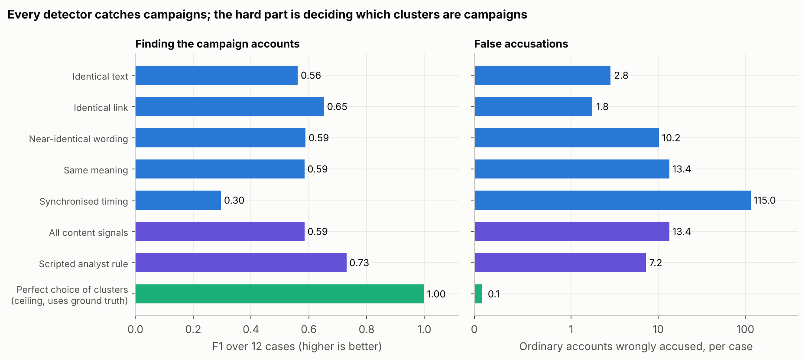
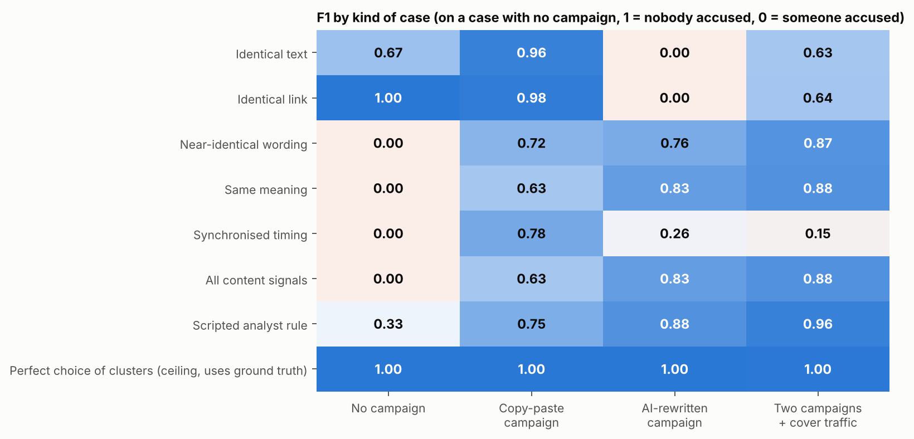

# Campaign Investigator

**An AI agent that investigates coordinated influence campaigns the way an analyst does:
choosing which detectors to run, reading their evidence, inspecting suspicious groups, and
filing a report that names the accounts it judges coordinated, and why.**

Detectors for coordinated inauthentic behaviour each look for one signal: identical text,
identical links, similar wording, the same meaning, or synchronised timing. Each one catches
some campaigns and wrongly flags ordinary people in other situations, for example everyone
who shares the same popular news story. Analysts combine the signals and use judgement. This
project asks whether a language-model agent, given the same detectors as tools, can make that
judgement, and compares it with fixed pipelines on cases where the truth is known.



---

## Finding 1: the evidence is there; the judgement is not

Twelve investigation cases (below), each a week of posts from about 600 accounts, with zero,
one or two hidden campaigns. Without any language model:

| Approach | F1 (mean of 12 cases) | Ordinary accounts wrongly accused, per case |
|---|---|---|
| Identical text only | 0.56 | 2.8 |
| Identical links only | 0.65 | 1.8 |
| Near-identical wording only | 0.59 | 10.2 |
| Same meaning only | 0.59 | 13.4 |
| Synchronised timing only | 0.30 | 115.0 |
| All content signals together | 0.59 | 13.4 |
| Scripted analyst rule (corroborated clusters of 5+) | 0.73 | 7.2 |
| **Perfect choice among the same clusters** (ceiling, uses ground truth) | **1.00** | **0.1** |

- **No single detector works across cases.** Identical text and links are near perfect on
  copy-paste campaigns (F1 0.96 and 0.98) and find nothing when the campaign rewrites its
  posts with AI. Meaning-based detection finds every rewritten campaign but also flags
  ordinary users who share the same news (24 false accusations per copy-paste case).
- **Timing alone accuses 182 ordinary accounts per case when there is no campaign at all.**
- **The clusters the detectors return already contain every campaign account.** Choosing the
  right clusters would give F1 1.00; the best fixed rule reaches 0.73 and still accuses 7
  ordinary accounts per case. **The bottleneck is judgement, not detection**, which is the job
  the agent is given.



## The agent

`src/agent.py`. The agent receives a short brief (find coordinated accounts; ordinary people
sharing popular news is not coordination; a false accusation is a serious error) and four
tools, and acts one JSON step at a time:

| Tool | Returns |
|---|---|
| `overview()` | size of the case, most-shared texts and links |
| `find_clusters(signal)` | groups of 3+ accounts that repeatedly posted the same thing within 15 minutes, for one of five signals |
| `inspect_cluster(signal, id)` | members, sample posts, overlap with other signals' clusters, share of members who also post exact copies |
| `inspect_account(handle)` | one account's activity, sample posts and cluster memberships |

It ends by filing a report: the clusters it judges coordinated (plus any accounts to add or
remove) and an explanation. Every detector is the real one from
[Beyond Copy-Paste](https://github.com/Zubair-DLCS/beyond-copy-paste); the agent only decides
what to run and what to believe. Each run records the full trace of actions and the final
explanation (`results/trace_*.jsonl`), so every accusation can be audited back to the evidence
the agent saw.

Measured for each model: F1, false accusations, missed accounts, steps used, which signals it
consulted, and whether it cited clusters it never looked at.

## Cases

`src/cases.py` builds the cases with the Beyond Copy-Paste benchmark (real text: human-written
Reddit comments, news headlines, IRA seed messages and AI paraphrases of them; simulated
behaviour; known ground truth). About 600 ordinary accounts per case, campaigns of 20
accounts, content only from the benchmark's held-out campaigns, and random account handles so
names reveal nothing:

| Kind | Cases | Hidden campaigns |
|---|---|---|
| No campaign | 3 | none: anything flagged is a false accusation |
| Copy-paste | 3 | one, posting identical text and links in bursts |
| AI-rewritten | 3 | one, using AI paraphrases, unique short links and 60-minute timing jitter |
| Mixed | 3 | one copy-paste and one AI-rewritten campaign, both hiding among ordinary-looking cover posts |

The cases ship with the repository in `data/cases/`.

## Run it

Free, no API key, on a Colab GPU:
[open the notebook in Colab](https://colab.research.google.com/github/Zubair-DLCS/campaign-investigator/blob/main/notebooks/run_on_colab.ipynb),
choose a T4 GPU (*Runtime > Change runtime type*) and run all cells. It runs the baselines,
serves two open models locally with Ollama, runs the agent on all 12 cases with each, and
draws the figures with the agents added.

Locally:

```bash
pip install -r requirements.txt
python src/baselines.py                                   # detectors and fixed rules
python src/run.py --provider ollama --model qwen2.5:7b    # the agent
python src/evaluate.py && python src/figures.py
python tests/test_agent.py                                # agent loop with a scripted stand-in model
```

Hosted models work too (Groq, Gemini, OpenRouter, OpenAI): set `LLM_API_KEY` and `LLM_RPM`
and pass `--provider` and `--model`.

## Limitations

- **Semi-synthetic cases.** The text is real but behaviour is simulated, so results describe
  this benchmark. Real investigations have messier evidence and no clean ground truth.
- **Twelve cases.** Enough to show where fixed rules break, too few for fine-grained
  comparisons between models.
- **The oracle is a ceiling, not a method.** It shows what perfect cluster-level judgement
  would achieve with these detectors.
- **Small open models.** The agent design is model-agnostic; stronger hosted models may do
  better at the same task.

## Credits

Benchmark and detectors: [Beyond Copy-Paste](https://github.com/Zubair-DLCS/beyond-copy-paste),
which builds on the CooRTweet and coorsim packages, GoEmotions
(Demszky et al., 2020), GloVe (Pennington et al., 2014) and the IRA tweet archive
(FiveThirtyEight; Linvill & Warren).

*Author: Zubair, PhD student, University of Malakand.*
